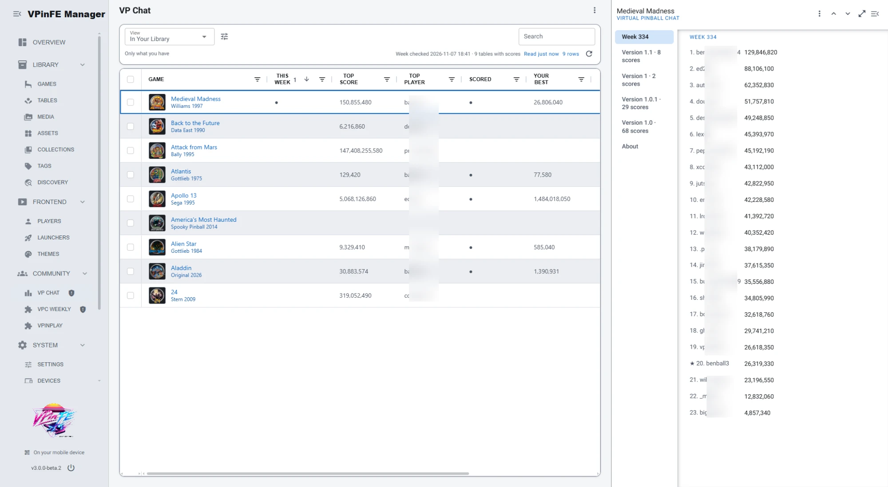
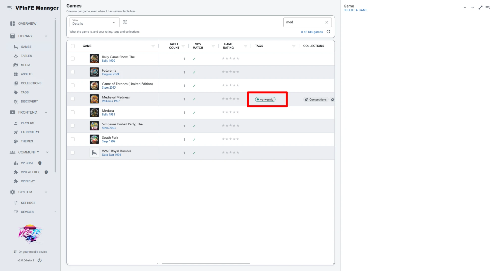
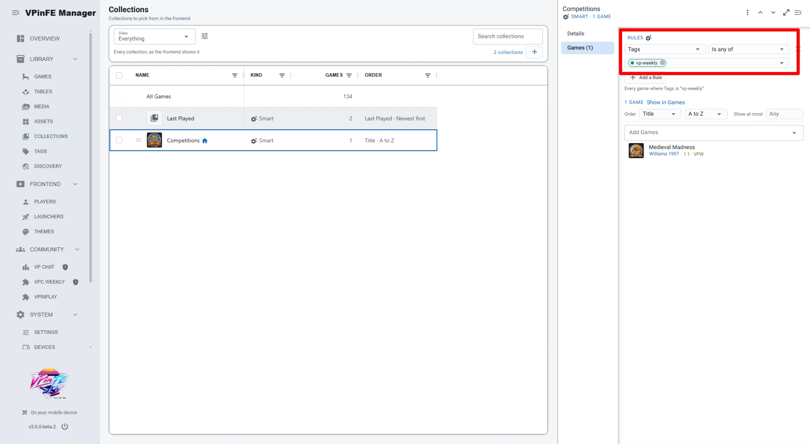

# Virtual Pinball Chat for VPinFE

> [!WARNING]
> **Work in progress.** This extension is under active development. Settings, the cached data
> and the `entry.ext` data given to themes may change in ways that break things between
> versions.

A [VPinFE](https://github.com/vpinfe/vpinfe) 3 extension for
[Virtual Pinball Chat](https://virtualpinballchat.com) (VPC): the weekly competition, and the
scores VPC holds for the tables in your library, with your own usernames flagged.

**The week's table is tagged `vpc-weekly` in your library**, and the tag moves when the week
changes, so a Smart collection on that tag always holds this week's table. See
[The weekly table in your collections](#the-weekly-table-in-your-collections).

## What it does



In the Manager, two entries under **Community**:

- **VP Chat** lists the weekly table and every table in your library whose scores have been
  asked of VPC. Columns show the top score and player, a dot under **Scored** where one of your
  usernames has a score on the table, your best score and rank, and when it was last checked.
  Scores are shown with thousands separators, and the weekly table (a dot under **This Week**) is
  listed first. There is an **All Tables** view and a **My Scores**
  view. Click a row for the boards: one section per VPC version of the table, showing the top 10
  and then **your own line with the lines around it**, so a rank of 87 is visible in context.
  Your lines are marked with a star.
- **VPC Weekly** holds only this week's table, and is what puts the `vpc-weekly` tag on it (see
  below).

**Scores for your themes.** Every game a theme draws gets its VPC leaderboards as
`entry.ext.vpc`: each version's top scores, with your own rank and best score picked out. The
weekly table also gets `entry.ext.vpc_weekly`, which holds the week and its board. A theme can
then show a table's leaderboard, your standing and the weekly competition right in the frontend,
with no setup of its own. See [For theme authors](#for-theme-authors) for the data.

## The weekly table in your collections

This extension tags this week's table `vpc-weekly` in your library, and moves the tag to the new
table when the week changes. Nothing else in your library is tagged, and you do not have to do
anything to keep it up to date.

The tag shows on the game like any other tag, so the weekly table is easy to spot when browsing:



To have a collection that always holds the week's table, go to **Library > Collections**, add a
**Smart** collection, and give it one rule: **Tags**, **Is any of**, `vpc-weekly`:



The collection follows the week on its own: when the week changes, the old table drops out and
the new one appears.

> [!NOTE]
> Earlier versions used the tag `vp-weekly`. If you set up a collection on that tag, change its
> rule to `vpc-weekly`.

The extension does this through its **VPC Weekly** list: the list is registered with the
`vpc-weekly` tag, and VPinFE tags the game of every row of a tagged list. That is why the tag sits
on its own one-row list and not on VP Chat, which would tag every table in it.

## How scores are collected

There is no crawl of VPC. Scores are asked for one game at a time, as they are wanted:

| When | What happens |
|---|---|
| You browse to a game | Its scores are used from the cache. If they were never fetched, or are older than **Keep Table Scores For**, one request for that game is queued |
| You play a game | It is marked, and asked for again the next time you browse to it at least 5 minutes later (VPC scores are posted by hand, so right at exit is too early) |
| **Check Now** (title menu) | Reads the week, then queues every game already held, one after another |
| **Refresh Scores** (row menu) | Queues the selected games |
| The weekly table | The last week is held between runs, so it is there at once; VPC is asked in the background a few seconds after VPinFE starts, then at the **Check the Weekly Table** interval |

A game is searched as `Name (Maker Year)`, such as `24 (Stern 2009)`, then by name alone, and
only versions that are one of the game's VPS table files are kept. Requests are made by one
worker, a second apart. A game VPC does not know is remembered as having no scores for the same
time.

Scores are kept in full (not just the top 10), and between runs, in `cache/scores.json` in this
folder. Delete it to start again.

## Settings

Under **Settings > Extensions**:

- **Your VPC Usernames**: comma separated. Matched ignoring case.
- **Check the Weekly Table**: only when VPinFE starts, or every 30 minutes (the default), hour,
  3, 6 or 12 hours, or day. VPinFE reads on a 30 minute tick, so a longer wait skips ticks.
- **Keep Table Scores For**: forever (the default), or 1, 3, 7 or 30 days, for every table that is not the
  weekly one.

## For theme authors

On the weekly game, `entry.ext.vpc_weekly` (empty on every other game):

```json
{"week": 334, "starts": "2026-11-02", "ends": "2026-11-08",
 "table": "Medieval Madness (Williams 1997)", "vps_release_id": "zbyQ01wi3L", "page": "https://...",
 "scores": [{"rank": 1, "player": "...", "score": 129846820, "posted": "2026-11-06T21:35:47",
             "url": "https://discord.com/...", "mine": false}]}
```

On any game with held scores, `entry.ext.vpc`:

```json
{"versions": [{"vps_release_id": "...", "version": "1.0.1", "authors": "...", "page": "https://...",
               "entries": 29, "scores": [{"rank": 1, "player": "...", "score": 1, "posted": "...",
                                          "url": "...", "mine": false}]}],
 "mine": [{"player": "...", "score": 1, "rank": 51, "of": 101, "version": "1.0.1",
           "vps_release_id": "..."}],
 "fetched": "2026-11-07T15:00:00Z"}
```

Each version's `scores` holds the top 25 plus your own lines, each with its true `rank`. The
version 0.1 weekly scores' `avatar`, `points` and `id` are no longer provided.

The weekly game is also tagged `vpc-weekly`; see
[The weekly table in your collections](#the-weekly-table-in-your-collections).

## Capabilities

| Capability | Why |
|---|---|
| `net:outbound` | To read the week and each game's scores from virtualpinballchat.com |
| `ui:mount` | For the VP Chat and VPC Weekly lists under Community |
| `config:own` | For the settings above |

| Scope | Why |
|---|---|
| `games:read` | To find which game a VPC table belongs to in VPinFE's VPS catalog. It changes nothing in your library |

## Code layout

`__init__.py` wires it up; `client.py` speaks to VPC; `library.py` finds the game; `store.py`
keeps scores in memory and on disk; `refresher.py` decides when to ask; `boards.py` ranks scores
and finds your lines; `community.py` draws the lists and theme entries.

## Install

Put this folder at `extensions/vpc_vpinfe` under the VPinFE config directory (the folder name
must stay `vpc_vpinfe`), restart VPinFE, and accept it under **Settings > Extensions**. It asks
again after an upgrade from 0.1 because of the new `config:own` capability.

Check it with:

```
vpinfe.exe --check-extension .
```
